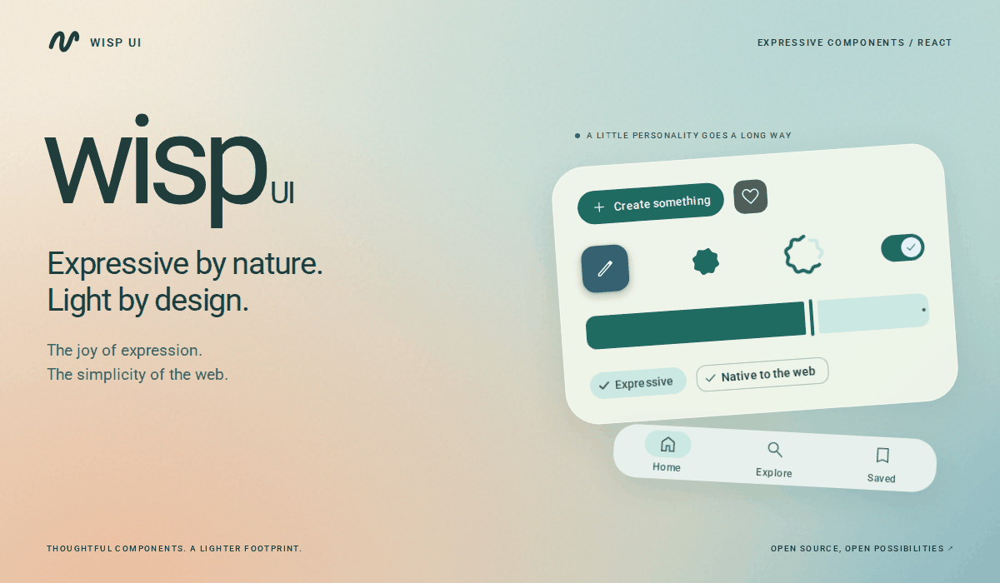
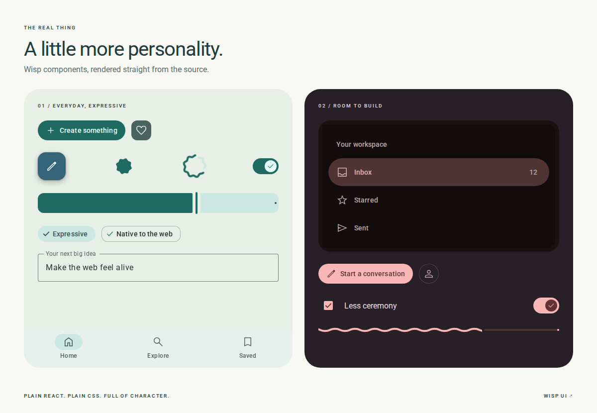

<h1 align="center">Wisp UI</h1>



<p align="center">
  <strong>Expressive React components, made for the web.</strong><br />
  Playful shapes. Thoughtful motion. Plain CSS. A lighter way to build.
</p>

<p align="center">
  <a href="https://r007.github.io/wisp-ui/">Documentation</a> ·
  <a href="https://r007.github.io/wisp-ui/components/">Components</a> ·
  <a href="https://r007.github.io/wisp-ui/storybook/">Storybook</a> ·
  <a href="CONTRIBUTING.md">Contribute</a>
</p>

> **Pre-alpha, and taking shape.** The component set is broad and well tested, but
> APIs and behaviour are still being refined. Expect changes before 1.0. The
> [component status](docs/COMPONENTS.md) lists what is covered.

## Expression, with the simplicity of the web

We wanted to build things that feel good: soft shapes, colours with personality,
motion that makes an interface feel alive. We wanted that in a React app, from the
first button to the navigation around it.

Getting there meant filling in gaps. We wanted navigation bars, drawers and rails
alongside the everyday controls. We wanted to use a handful of components without
bringing along the rest of a kit's styles. And we wanted to work with the DOM and
CSS we already knew.

**That's why we built Wisp.** Expressive components with static, per-component CSS
and a preference for what the browser already does well. Native inputs. Native
dialogs. Popovers. Scroll snapping. Small pieces that leave room for your
application.

The name is the idea: something light, with a little life of its own.

## A little more personality



These are **Wisp components rendered from this repository**, with palettes
generated from seed colours. The artwork's [React and CSS source](docs/brand/) is
included, so the previews can grow with the library.

Buttons that change shape. A loading indicator that morphs. Wavy progress.
Navigation that belongs to the same family as your forms. Explore the variants,
keyboard interactions, colours and motion in the
[documentation](https://r007.github.io/wisp-ui/) and in
[Storybook](https://r007.github.io/wisp-ui/storybook/).

## Light where it matters

- **Import a component, bring its styles.** Each component owns its CSS. Composed
  components include the pieces they use; the shared theme is loaded once.
  [CI checks](packages/react/scripts/check-treeshake.ts) both barrel and subpath
  imports for unrelated styles and a compressed CSS budget.
- **Your DOM. Your CSS.** React elements, CSS Modules and custom properties.
  No shadow DOM, Sass setup or CSS-in-JS runtime. Styles live in the `wisp`
  cascade layer, ready for your own classes and tokens.
- **Let the browser do its job.** Dialogs use `<dialog>`, form controls use native
  inputs, menus use popovers and CSS anchor positioning, and carousels use native
  scrolling. JavaScript handles the behaviour and motion that need it.
- **Few dependencies, deliberately.** The React package depends on Wisp's tokens;
  the token package uses a colour library to generate palettes. React 19 is a peer
  dependency. Icons and fonts are yours to choose.
- **Expressive all the way through.** Tokens supply colour, type, shape, elevation
  and motion. Seed-based palettes, light and dark schemes, contrast options,
  reduced-motion support and a calmer spring set are part of the foundations.
- **Shapes that morph.** Thirty-five ready-made shapes and an exact,
  feature-matched morph between any two, as a spring.

### Beyond the button

| Build               | With Wisp                                                                              |
| ------------------- | -------------------------------------------------------------------------------------- |
| A way around        | Navigation bar, rail and drawer; top and bottom app bars; tabs                         |
| A way to act        | Buttons, button groups, split buttons, icon buttons, FABs and FAB menus                |
| A way to enter      | Text fields, select, autocomplete, search, checkboxes, radios, switches and sliders    |
| A way to choose     | Chips, menus, date pickers, date ranges and time pickers                               |
| A way to respond    | Dialogs, sheets, snackbars, banners, tooltips, progress and loading indicators         |
| A place for content | Cards, lists, carousels, accordions, badges, dividers, toolbars, typography and shapes |

See the [full inventory and implementation notes](docs/COMPONENTS.md).

## Try it

```bash
npm install @wisp-ui/react
```

Import the shared theme once at your app root, then the components you use:

```tsx
import '@wisp-ui/react/theme.css';
import { Button } from '@wisp-ui/react/button';

export function Save() {
  return <Button variant="filled">Save something good</Button>;
}
```

Barrel imports work too: `import { Button } from '@wisp-ui/react'`.
Components ship as ESM with `"use client"` directives preserved where needed.
Use a bundler that supports CSS imports. This is a React kit; its light footprint
comes from the implementation, not from removing React. Requires **React 19**.

To work on Wisp itself, you need **Node ≥ 22.18** and **pnpm 12** (the repository
pins the exact version):

```bash
git clone https://github.com/r007/wisp-ui.git
cd wisp-ui
pnpm install
pnpm storybook
```

Open **http://localhost:6006/**. Change the colour scheme, seed colour, spring
motion and contrast from the toolbar. Storybook runs from source; no package build
is needed first.

## Make it feel like you

Generate a palette from one seed colour:

```ts
import { applyTheme } from '@wisp-ui/react/theme';

applyTheme(document.documentElement, '#006a60', { variant: 'expressive' });
```

Colour follows CSS `color-scheme`, so dark mode is one property. Choose it for the
page with the `useColorScheme` hook (it remembers the choice, and a one-line script
avoids a flash of the wrong theme), or set it on a subtree:

```css
.reading-pane {
  color-scheme: dark;
}

.checkout {
  --md-comp-button-filled-container-color: var(--md-sys-color-tertiary);
}
```

No theme provider is required. Dynamic colour is optional: `theme.css` includes
the baseline palette. The [theming](https://r007.github.io/wisp-ui/docs/theming/)
and [dark mode](https://r007.github.io/wisp-ui/docs/dark-mode/) guides go further.

<details>
<summary><strong>Motion, contrast and the CSS cascade</strong></summary>

Set `data-wisp-motion="standard"` for the calmer spring set. The baseline theme
supports `data-wisp-contrast="medium"` or `"high"`; `prefers-contrast: more` selects
high contrast automatically unless an explicit attribute overrides it. When
generating a seed palette, pass a `contrast` value to `applyTheme` instead.

Wisp's styles live in `@layer wisp`. Unlayered app styles take precedence. Put a
global reset in an earlier layer so it does not accidentally override components:

```css
@layer reset, wisp;

@layer reset {
  button {
    font: inherit;
  }
}
```

</details>

## Built with care, in the open

Wisp's design values are data, imported and compiled into CSS; the components
describe structure and behaviour on top of them, using browser primitives. Read the
[architecture](docs/architecture.md), the
[platform-first decision](docs/adr/0004-platform-first.md) and the
[porting guide](docs/porting-guide.md) for the reasoning.

| Package                              | Purpose                                                      |
| ------------------------------------ | ------------------------------------------------------------ |
| [`@wisp-ui/react`](packages/react)   | Components, per-component styles and Storybook               |
| [`@wisp-ui/tokens`](packages/tokens) | CSS custom properties, dynamic colour and dark-mode helpers  |
| [`apps/docs`](apps/docs)             | The documentation site; never published                      |
| [`tools/codegen`](tools/codegen)     | Build-time token importer and CSS generator; never published |

### Help shape what comes next

Try a component in a real layout. Test it with a keyboard. Find a rough edge.
Tell us what feels good and what gets in the way. Pre-alpha is the time to make
those details better together.

[Report an issue](https://github.com/r007/wisp-ui/issues) or start with the
[contributing guide](CONTRIBUTING.md).

<details>
<summary><strong>Development commands</strong></summary>

```bash
pnpm test
pnpm test:dark
pnpm lint
pnpm typecheck
pnpm build
pnpm --filter @wisp-ui/react check:treeshake
pnpm --filter @wisp-ui/docs dev
```

Tests run in a real browser with Vitest and Playwright. Install Chromium first:

```bash
pnpm --filter @wisp-ui/react exec playwright install chromium
```

If your home disk is tight, set `PLAYWRIGHT_BROWSERS_PATH` to another location.
If pnpm is unavailable, install it separately; Node 26 no longer ships Corepack.

</details>

## Licence & credits

[Apache-2.0](LICENSE). Wisp adapts open-source work, with thanks: its design token
data, shape algorithms and some ripple and elevation logic. The notices are in
[NOTICE](NOTICE), [THIRD_PARTY_LICENSES.md](THIRD_PARTY_LICENSES.md) and the
[credits page](https://r007.github.io/wisp-ui/docs/licences/).

Wisp is an independent project.
