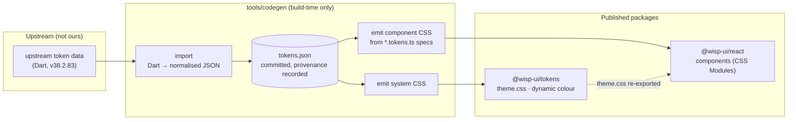

# Architecture

Wisp has one idea at its core: **design values are data, and components are thin.**
Colours, sizes, shapes and motion are imported as tokens and compiled to
CSS; the hand-written code only describes structure and behaviour.



## Layers

### 1. Tokens (`tools/codegen`, `packages/tokens`)

`pnpm codegen import --source <upstream checkout>` parses the Dart
token files into `tools/codegen/data/tokens.json`. The parser is deliberately
strict: an unknown value shape throws instead of being skipped, and a count check
fails if any documented token is not parsed. The JSON records the repository, commit
and token release it came from, and is committed (one token per line, so upstream
updates produce reviewable diffs).

Some tokens come in interchangeable **schemes** that reuse the same names:
light/dark colour (with medium/high contrast as _overlays_ that only restate what
changes) and Standard/Expressive motion. The importer models these separately and
checks they are consistent.

`pnpm codegen generate` then writes:

| Output                                                | Contents                                                                                                                |
| ----------------------------------------------------- | ----------------------------------------------------------------------------------------------------------------------- |
| `packages/tokens/src/theme.generated.css`             | System tokens: colour roles (`light-dark()`), type scale, shape, elevation, state, motion durations/easings and springs |
| `packages/react/src/**/*.tokens.generated.module.css` | Each component's token defaults, from its `*.tokens.ts` spec                                                            |
| `packages/tokens/src/color-roles.generated.ts`        | The colour role list, for runtime theming                                                                               |

All generated files are committed, and a test fails if they drift from the emitters.

### 2. Component token specs (`*.tokens.ts`)

A spec says which tokens feed which private variable of a component:

```ts
{
  selector: '.filled',
  prefix: 'md.comp.button.filled',
  vars: {
    'container-color': 'container.color',
    // An array asserts every token has the same value.
    'label-color': ['label-text.color', 'hovered.label-text.color', 'pressed.label-text.color'],
  },
}
```

That emits:

```css
.filled {
  --_container-color: var(--md-comp-button-filled-container-color, var(--md-sys-color-primary));
}
```

- The first `var()` is the **public override**: the token's own name, which
  a consumer can set on any ancestor.
- The fallback is the default, expressed in system tokens, so theming,
  dark mode and contrast still flow through.
- Arrays are **generation-time invariants.** The hand-written CSS simplifies (one
  label colour for rest/hover/press); if an upstream update ever makes those
  tokens diverge, generation fails and tells you which ones, instead of the
  component being quietly wrong.

Only the tokens a component uses are emitted. The whole Expressive Button (5
variants × 5 sizes × toggle) is ~15 kB of token CSS, ~1.6 kB gzipped, rather than
the ~360 tokens published for it.

### 3. Components (`packages/react`)

Each component is a folder:

```
button/
  button.tsx                     behaviour + markup
  button.module.css              structure only: never a literal colour, size or timing
  button.tokens.ts               token spec  (build-time; not published)
  button.tokens.generated.module.css
  button.stories.tsx  button.test.tsx
  index.ts
```

Shared building blocks live in `foundation/`:

| Piece                               | Purpose                                                                                  |
| ----------------------------------- | ---------------------------------------------------------------------------------------- |
| `usePressable`                      | button-or-link semantics, disabled links, toggle state, press ripple                     |
| `StateLayer` + `RippleController`   | hover/focus tint and the press ripple (hover and focus are CSS; only the press needs JS) |
| `focus-ring.module.css`             | the 3px/2px focus indicator                                                              |
| `renderElement` / `RenderProp`      | the `render` prop, for router links                                                      |
| `useControllableState`, `mergeRefs` | controlled/uncontrolled state and ref merging                                            |

## Decisions that shape the code

**CSS Modules + modern CSS, not CSS-in-JS** ([ADR 0001](adr/0001-styling.md)).
Zero runtime, per-component CSS, no provider, and it is plain CSS a reader can
follow. The browser features doing the work: `@layer`, custom properties,
`light-dark()`, `color-mix()`, `:has()`, `@starting-style`, `linear()`.

**Cascade layers.** All library CSS is in `@layer wisp`, so unlayered consumer
CSS always wins regardless of specificity.

**Springs without JavaScript** ([ADR 0003](adr/0003-springs.md)). Expressive
describes motion as physics. The codegen solves the spring analytically and emits a
CSS `linear()` easing, e.g. `--md-sys-motion-spring-fast-spatial: 344ms linear(…)`,
used as `transition: border-radius var(--md-sys-motion-spring-fast-spatial)`.
Spatial springs overshoot (that's the Expressive feel); effects springs do not.
Standard vs Expressive is one attribute (`data-wisp-motion`).

**Platform first** ([ADR 0004](adr/0004-platform-first.md)). `<dialog>` for modals
(focus containment, inert page, Escape, top layer), a real `<input type="checkbox"
role="switch">` for the switch, `<nav>`/`<ul>` for navigation, `:dir(rtl)` for
direction. This is less code, better accessibility, and it works with forms.

**Component CSS ships as plain `.css`.** The library build emits each component's
already-scoped CSS as a plain file imported by that component's JS. A bare import
of an unused CSS _Module_ is dropped by consumers' bundlers, which would silently
lose styles; plain CSS is always kept. `pnpm check:treeshake` bundles each
component alone and fails if another component's CSS appears or the budget
(4 kB gzipped CSS per component) is exceeded.

## Conventions every component follows

- **No literal colours, sizes or timings** in hand-written CSS (Stylelint and a
  test enforce colours and `transition` timings).
- **Everything inside `@layer wisp`** (a test enforces it).
- **State from the DOM:** `aria-current`, `aria-pressed`, `:checked`, `:disabled`,
  `:focus-visible`, not custom state classes.
- **Stable hooks:** `data-variant`, `data-size`, `data-selected`, `data-slot` for
  styling and tests; hashed class names are not API.
- **Accessible by construction:** icon-only controls require `aria-label`; landmarks
  require a name; decorative icons are `aria-hidden`; badges are announced after the label.
- **Respect the user:** `prefers-reduced-motion`, `forced-colors`, RTL, 48px touch
  targets, `rem`-based type.
- **Tests run in a real browser** (Vitest + Playwright), because the behaviour is
  CSS: springs, `:focus-visible`, `::backdrop`. jsdom implements none of it.

## What is deliberately not here yet

See [COMPONENTS.md](COMPONENTS.md) for the full status. Notable gaps in the
foundation: a stepper and a data table.
